<div align="center">

# 🐠 ים של ציורים · Doodle Sea

**צובעים חיית ים על דף · מצלמים בטלפון · והיא שוחה באקווריום על הטלוויזיה**

*Color a sea creature on paper, snap it with your phone, and watch it swim across your TV.*


`ללא התקנות` · `ללא אינטרנט` · `ללא ענן` · `Node.js בלבד`

</div>

---

<div dir="rtl">

## מה זה?

ים של ציורים הוא פעילות משפחתית לסלון. מדפיסים דף צביעה, הילדים (וההורים, והנערים) צובעים, מצלמים את הדף בטלפון, ותוך שניות החיה שצבעתם מופיעה על הטלוויזיה ושוחה בין האצות, הלוויתנים והסרטנים. מצביעים על המסך וצועקים **"הנה הדג שלי!"**

הכול רץ **בבית, ברשת ה-Wi-Fi שלכם**. אין חשבון, אין שרת בענן, אין העלאת תמונות לשום מקום. מחשב אחד מחובר לטלוויזיה, והטלפונים מתחברים אליו.

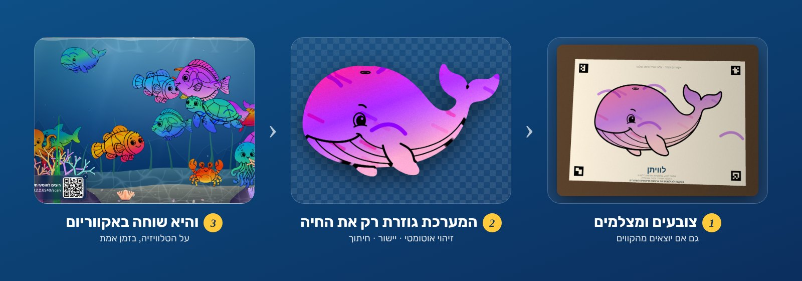

## למה זה כיף

<ul dir="rtl">
<li><b>מותר לצאת מהקווים.</b> המערכת מזהה את הדף, מיישרת אותו, ו<b>גוזרת רק את החיה</b> לפי קו המתאר, גם אם צבעתם מחוץ לקו. קשקושים, טוש שנמרח, צל על הדף, תאורה צהבהבה: מסתדרים.</li>
<li><b>עובד עם כל טלפון.</b> בלי אפליקציה. סורקים QR ופותחים דף ווב.</li>
<li><b>שם לכל חיה.</b> לפני השליחה אפשר לתת שם, והוא מופיע כשהחיה מצטרפת.</li>
<li><b>12 חיות מאוירות</b>: דולפין, לוויתן, כריש, צב ים, תמנון, מדוזה, סוס ים, סרטן, מנטה, דג מלאך, דג ליצן ונתחן כחול. קל להוסיף עוד.</li>
<li><b>חיים באקווריום</b>: החיות שוחות לכיוון שהן מסתכלות, הגוף מתעקל בתנועה, יש שמש מתחת למים, בועות, אצות וצלילי ים רגועים.</li>
<li><b>מרגיש כמו משחק</b>: האכלה, "איפה הדג שלי?", קפיצה, גלים, ושמיים שמשתנים לפי השעה.</li>
<li><b>בנוי להשאיר דלוק</b>: חסכוני במעבד, ממשק שמתעמעם לבד, ומצב "לילה טוב" לשינה.</li>
</ul>

## צילומי מסך

### מסך הפתיחה והאקווריום

| מסך הפתיחה | האקווריום עם החיות של המשפחה |
|:--:|:--:|
| 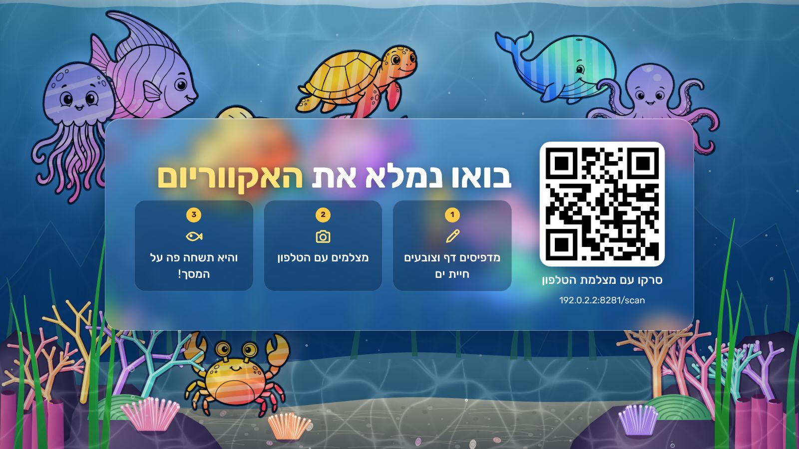 | 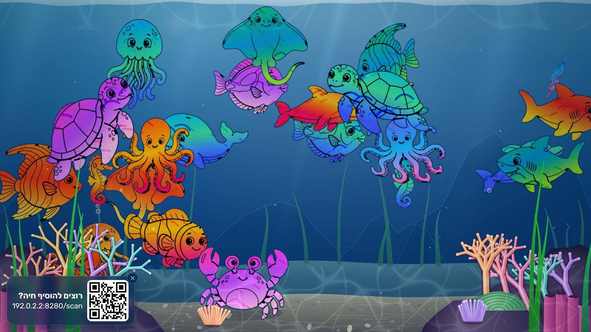 |

קוד ה-QR בפינה השמאלית התחתונה נשאר על המסך כדי שכל אורח יוכל להצטרף. אפשר להסתיר אותו בכפתור ה-✕, ולהחזיר אותו מהלשונית הקטנה או בלחיצה על `Q`.

### שמיים לפי השעה

| יום | שקיעה | לילה |
|:--:|:--:|:--:|
|  | 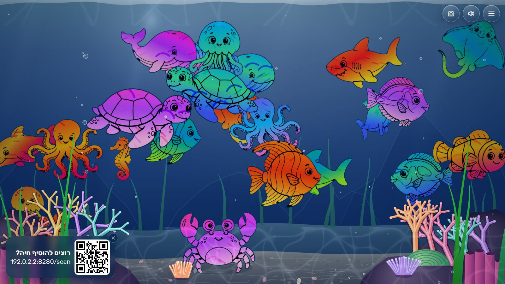 | 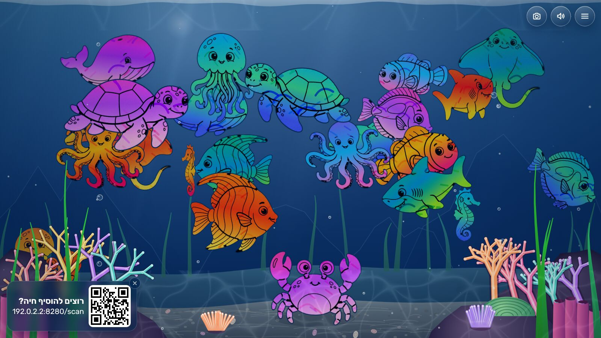 |

### התפריט במסך הטלוויזיה

| הדגים | כרטיס חיה | הוספה |
|:--:|:--:|:--:|
| 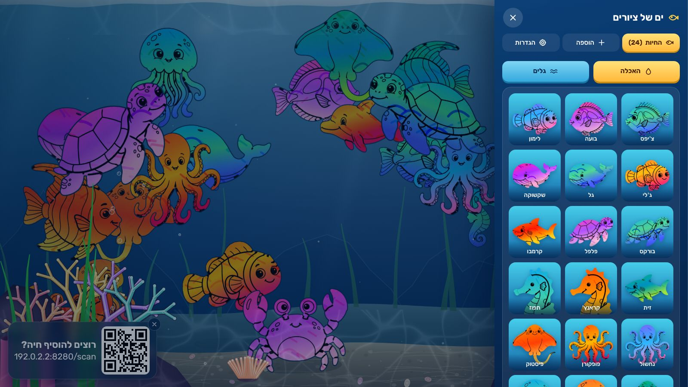 | 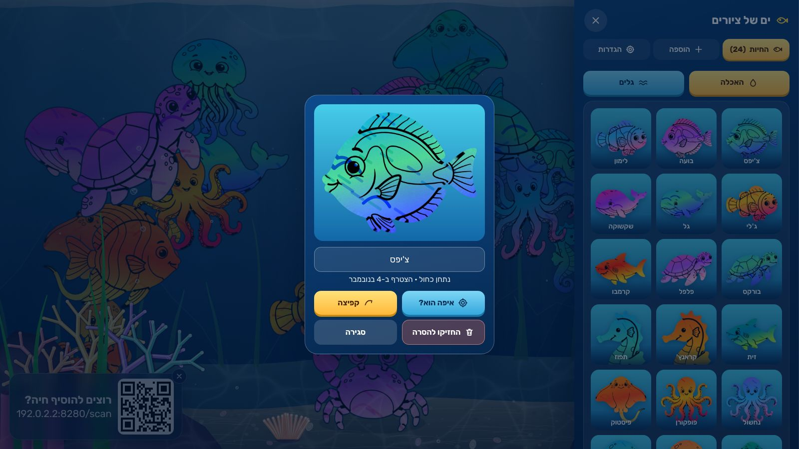 | 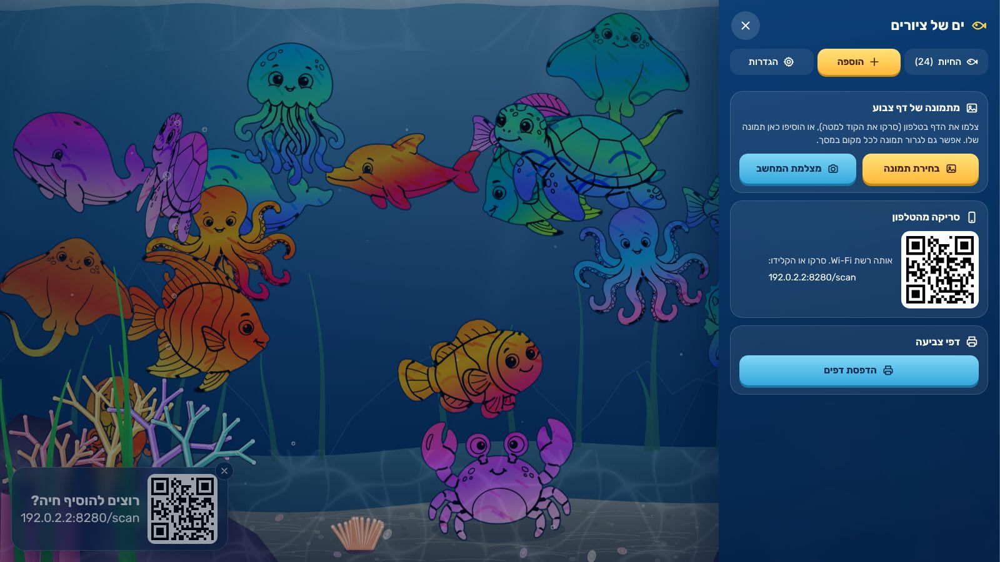 |

| הגדרות: צלילים ושיר | הגדרות: שמיים ותצוגה |
|:--:|:--:|
| 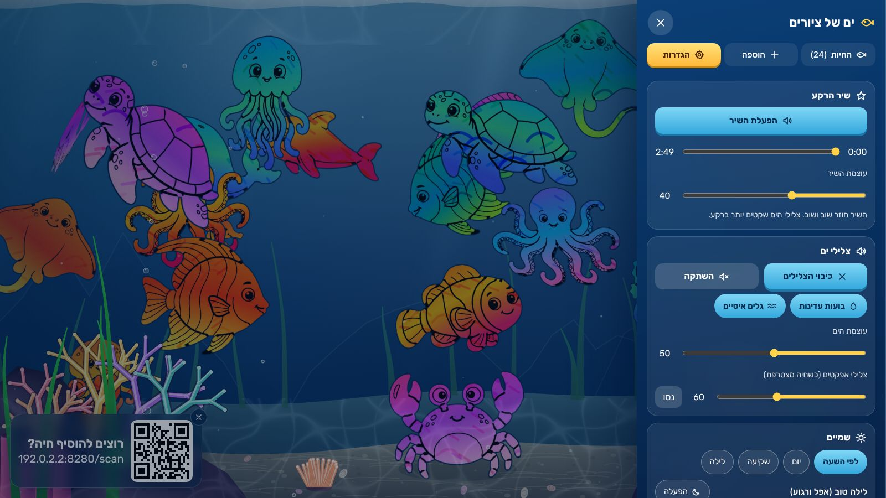 | 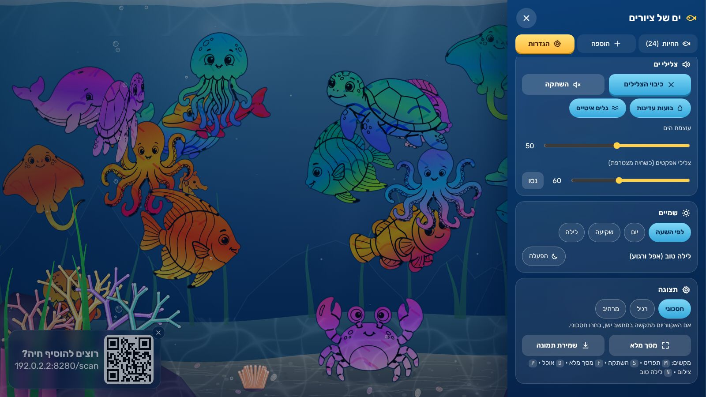 |

### בטלפון

| סריקה | תצוגה מקדימה + שם | נשלח! | האכלה | הדגים שלי |
|:--:|:--:|:--:|:--:|:--:|
| 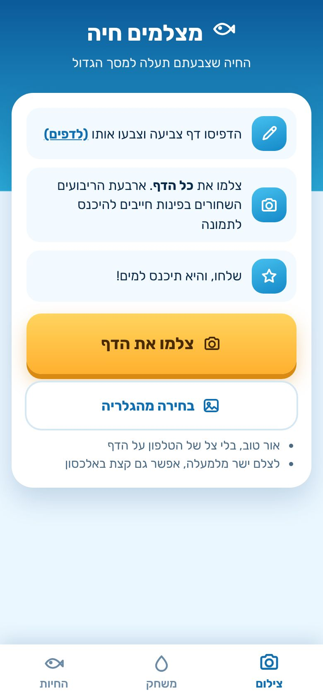 | 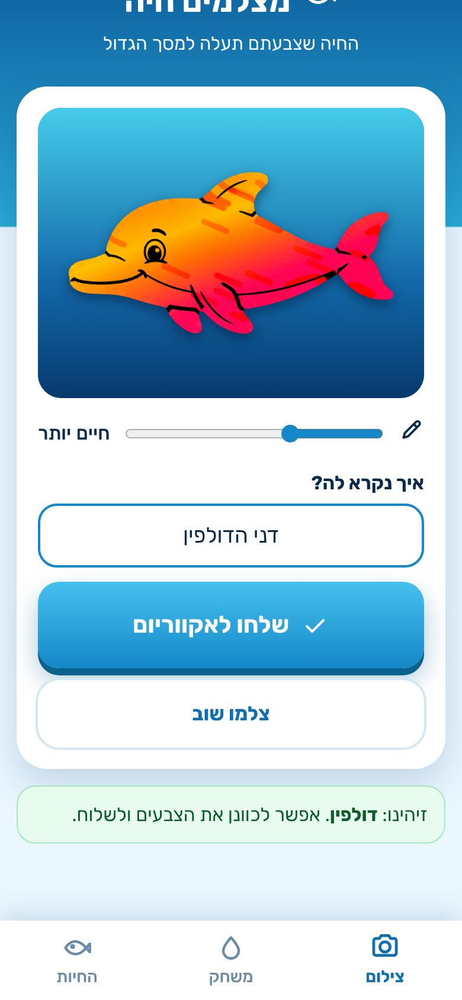 | 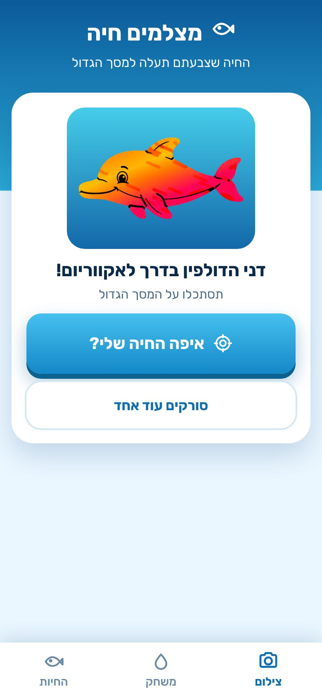 | 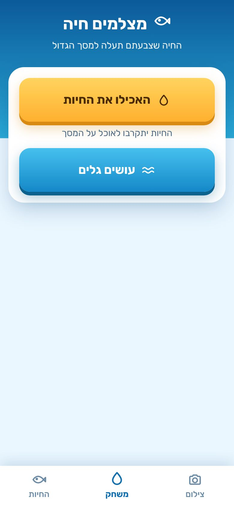 | 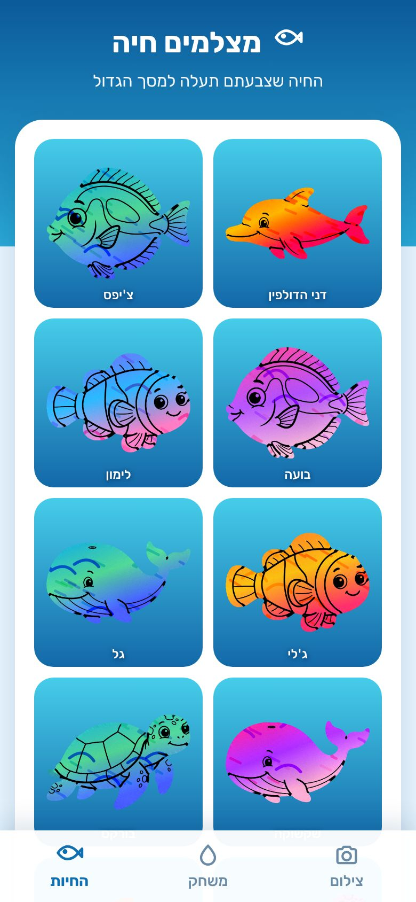 |

### הדפסה

| בחירת דפים | נבחרו שני דפים |
|:--:|:--:|
| 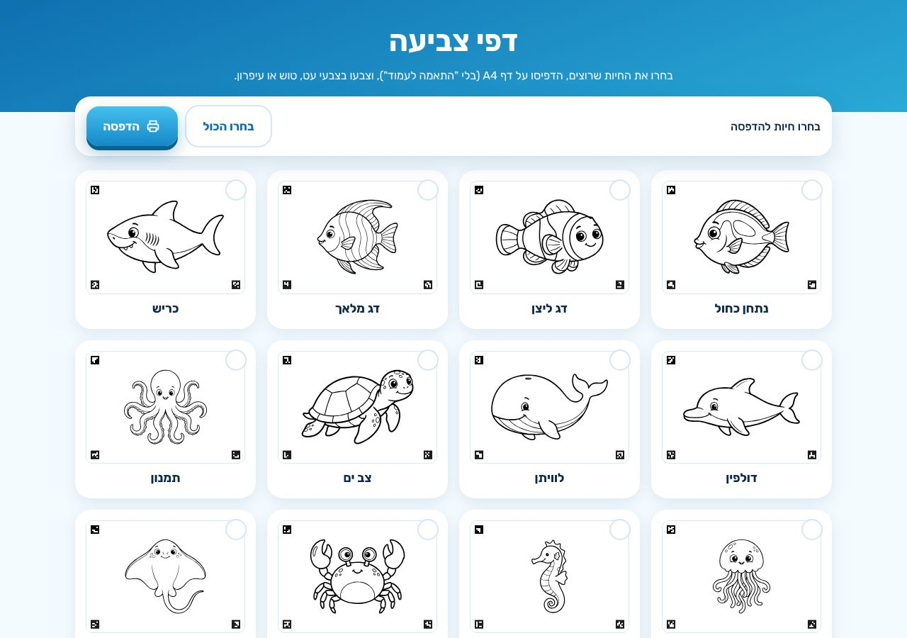 | 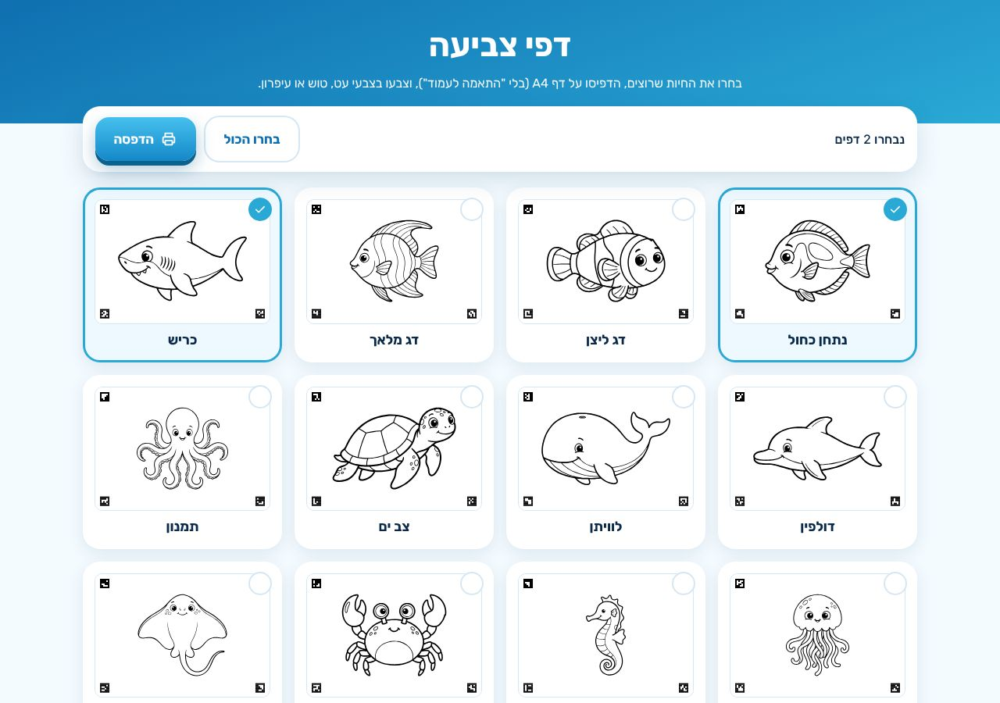 |

## התחלה מהירה

**מה צריך:**

<ul dir="rtl">
<li>מחשב אחד שמחובר לטלוויזיה (Windows, Mac או Linux).</li>
<li>תוכנת Node.js בגרסה 18 ומעלה.</li>
<li>אין התקנות נוספות, ואין צורך ב-<code>npm install</code>.</li>
</ul>

**איך מפעילים:**

<ul dir="rtl">
<li><b>ב-Windows</b> לוחצים לחיצה כפולה על הקובץ <code>start.bat</code></li>
<li><b>ב-Mac</b> לוחצים לחיצה כפולה על הקובץ <code>start.command</code> (בפעם הראשונה: קליק ימני ואז "פתיחה")</li>
<li><b>בכל מערכת אחרת (למשל Linux)</b> מריצים בטרמינל את שלוש השורות האלה</li>
</ul>

```bash
git clone https://github.com/valior25/doodle-sea.git
cd doodle-sea
node server.js
```

**אחרי שהשרת עלה:**

<ol dir="rtl">
<li>בטלוויזיה (או במחשב המחובר אליה) פותחים את הכתובת הזאת, ולוחצים <b>F</b> למסך מלא:
<pre dir="ltr">http://localhost:8000/tv</pre></li>
<li>מדפיסים דפי צביעה מהכתובת הזאת. ההגדרות: <b>A4 לרוחב, גודל 100%</b>, בלי "התאמה לעמוד":
<pre dir="ltr">http://localhost:8000/print</pre></li>
<li>הילדים צובעים. <b>רק ארבעת הריבועים השחורים שבפינות צריכים להישאר נקיים.</b></li>
<li>בטלפון (באותה רשת Wi-Fi) סורקים את קוד ה-QR שעל המסך, מצלמים <b>את כל הדף</b>, נותנים שם ושולחים.</li>
</ol>

> אם הטלפון לא מתחבר: ודאו שהוא באותה רשת (לא רשת אורחים), ושחומת האש מאפשרת ל-Node חיבורים נכנסים. בפעם הראשונה Windows ו-macOS שואלים על זה, ויש ללחוץ "אפשר".

### מקשים בטלוויזיה

| מקש | פעולה |
|---|---|
| `F` | מסך מלא |
| `M` | תפריט |
| `Q` | הצגה / הסתרה של קוד ה-QR |
| `D` | פיזור אוכל |
| `S` | השתקה |
| `N` | "לילה טוב" |
| `P` | צילום של האקווריום |

### הפעלה על אנדרואיד (Termux)

אפשר להריץ את השרת גם על טלפון אנדרואיד ישן שמשמש כמחשב הבית. ראו [`ANDROID.md`](ANDROID.md).

## איך הסריקה עובדת

הדף המודפס מכיל **ארבעה סימנים** בפינות, והם מזהים את הדף.

<ol dir="rtl">
<li><b>זיהוי:</b> כל פינה היא קוד ייחודי של 4×4 תאים (מזהה את החיה ואת הפינה, ועמיד בסיבוב). לפי הקודים יודעים איזו חיה בדף (בלי לבחור) ואיפה הפינות.</li>
<li><b>יישור:</b> התמונה מיושרת בפרספקטיבה (הומוגרפיה), כאילו צולמה מלמעלה בדיוק.</li>
<li><b>ניטרול תאורה:</b> הרקע של הדף מנורמל, כך שצל או תאורה צהבהבה לא משנים את הצבעים. אפשר גם לחזק צבעים עם הסליידר.</li>
<li><b>חיתוך:</b> המסכה נלקחת מקו המתאר של החיה. כל מה שמחוץ לגוף נחתך, וקווי המתאר והפרטים נשארים.</li>
<li><b>שליחה:</b> התוצאה נשלחת כ-PNG שקוף, והשרת מעדכן את כל המסכים בזמן אמת.</li>
</ol>

דף **בדיקת מערכת** (`http://localhost:8000/check`) בודק שהשרת, הדפדפן, המצלמה, הצליל והסריקה עובדים על המכשיר שפתחתם בו אותו.

## תוכן הפרויקט

| נתיב | תפקיד |
|---|---|
| `server.js` | שרת ללא תלויות: קבצים סטטיים, API, עדכונים חיים (SSE), הגבלות קצב, בדיקות מקור |
| `public/tv.html`, `tv.js` | האקווריום (Canvas 2D): שמיים, קרניים, אצות, חלקיקים, תנועת החיות, דרגות איכות אוטומטיות |
| `public/scan.html`, `scan.js` | דף הטלפון: סריקה, תצוגה, שם, האכלה, הדגים שלי |
| `public/capture.js` | זיהוי סימנים, יישור, ניטרול תאורה וחיתוך |
| `public/creatures.js` | הגדרות החיות: שם, תנועה, גודל, ציור וקו חיתוך |
| `public/sheet.js`, `print.html` | יצירת דפי הצביעה והדפסה |
| `public/menu.js` | התפריט בטלוויזיה |
| `public/sound.js`, `music.js` | צלילי ים ושיר רקע (אופציונלי), נוצרים בקוד |
| `public/art/` | ציורי הקווים (PNG ו-SVG) |
| `tools/` | בדיקות ושירות: בדיקות שרת, יצירת תמונות סריקה לבדיקה, צילומי מסך |

הנתונים (הדגים שנסרקו) נשמרים בתיקיית `data/` ליד השרת. למחיקה: עוצרים את השרת ומוחקים אותה.

## הוספת חיה חדשה

<ol dir="rtl">
<li>שמרו קובץ קווי מתאר שחור-לבן (רקע לבן, קו עבה וסגור).</li>
<li>חותכים אותה ומחשבים את קו החיתוך:
<pre dir="ltr">python3 tools/add_art2.py drawing.png my_animal x0,y0,x1,y1</pre></li>
<li>יוצרים גרסת SVG חדה להדפסה:
<pre dir="ltr">python3 tools/vectorize.py my_animal</pre></li>
<li>מוסיפים שורה ב-<code>public/creatures.js</code>, ואת ה-id לרשימה <code>KNOWN</code> ב-<code>server.js</code>:
<pre dir="ltr">add({ id: 'my_animal', he: 'שם', motion: 'swim', size: 1, art: {...}, d: '...' })</pre></li>
</ol>

## בדיקות

```bash
REEF_NO_LIMIT=1 PORT=8000 node server.js &
node tools/selftest.js 8000
node tools/qa_gen.js /tmp/qa 8000 3
node tools/qa_upload.js /tmp/qa 8000
node tools/shots.js 8000 8001 docs/screens
node tools/motion/render.js
```

| פקודה | מה היא עושה |
|---|---|
| `REEF_NO_LIMIT=1 ... node server.js` | שרת לבדיקות, בלי הגבלות קצב |
| `selftest.js` | 28 בדיקות שרת ואבטחה |
| `qa_gen.js` | תמונות סריקה עם קשקושים מחוץ לקווים, 3 לכל חיה |
| `qa_upload.js` | מעלה אותן דרך דף הסריקה האמיתי ובודק זיהוי |
| `shots.js` | צילומי המסך של ה-README |
| `motion/render.js` | האנימציה שבראש ה-README (`docs/demo.gif`) |

בדיקת קצה שרצה: 36 תמונות (12 חיות × 3), עם צבעים שיוצאים מהקווים, סיבוב, פרספקטיבה, צל ורעש. כולן זוהו נכון ונחתכו לפי צורת החיה.

## פרטיות ואבטחה

<ul dir="rtl">
<li>הכול נשאר ברשת הביתית. אין שום בקשה החוצה.</li>
<li>השרת מקשיב ב-<code>0.0.0.0</code> כדי שטלפונים יתחברו, לכן <b>מומלץ להריץ רק ברשת ביתית מהימנה</b>.</li>
<li>יש בדיקת מקור וכתובת (Same-Origin + Host), הגבלות קצב, בדיקת תקינות לקבצי ה-PNG, ושמות מנוקים מתווים מסוכנים.</li>
<li>בדיקות השרת מכסות את אלה (<code>tools/selftest.js</code>).</li>
</ul>

משתני סביבה:

| משתנה | משמעות |
|---|---|
| `PORT` | הפורט של השרת (ברירת מחדל 8000) |
| `REEF_DATA` | תיקיית הנתונים |
| `REEF_UPLOAD_LIMIT` | מספר העלאות בדקה (ברירת מחדל 10) |
| `REEF_NO_LIMIT=1` | ביטול ההגבלות, לבדיקות בלבד |

## פתרון בעיות

| בעיה | פתרון |
|---|---|
| הסריקה אומרת "לא רואים את הסימנים" | לצלם את **כל** הדף, באור טוב, בלי שיד מכסה פינה. ארבעת הריבועים השחורים חייבים להיכנס |
| החיה נחתכת לא מדויק | להדפיס ב-100% בלי "התאמה לעמוד", ולא לצבוע על הקו השחור בעוצמה גבוהה מדי |
| הטלפון לא נכנס | אותה רשת Wi-Fi? חומת אש? כתובת ה-QR צריכה להיות כתובת רשת (192.168...) |
| אין צליל | הדפדפן דורש לחיצה ראשונה על המסך. אחר כך הצליל מתחיל |
| שינוי שלא מופיע | רענון קשיח (Ctrl+F5) |

## קרדיטים ורישיון

<ul dir="rtl">
<li>רישיון <b>MIT</b>, ראו <a href="LICENSE"><code>LICENSE</code></a>.</li>
<li>גופן <a href="https://github.com/googlefonts/rubik">Rubik</a> (SIL Open Font License).</li>
<li>ספריית QR: <a href="https://github.com/kazuhikoarase/qrcode-generator">qrcode-generator</a> (MIT), כלולה ב-<code>public/vendor</code>.</li>
<li>ציורי החיות הם חלק מהפרויקט. אם אתם מוסיפים ציורים משלכם, ודאו שיש לכם זכות להשתמש בהם.</li>
<li><b>צלילי הרקע נוצרים בקוד.</b> כל הצלילים (גלים, בועות, צליל ההצטרפות) מסונתזים בדפדפן, בלי קבצי שמע. אין בפרויקט שירים או הקלטות של אחרים.</li>
<li><b>שיר רקע פרטי (לא חובה).</b> לשימוש ביתי אפשר להניח קובץ MP3 משלכם בנתיב הזה. התיקייה מוחרגת מ-git ולא תעלה לגיטהאב:
<pre dir="ltr">public/audio/under-the-sea.mp3</pre></li>
</ul>

</div>

---

## English

**Doodle Sea** is a living-room family activity. Print a coloring sheet of a sea creature, color it (going outside the lines is fine), photograph it with your phone, and it appears and swims on your TV in a shared aquarium. Everything runs on your home network. No accounts, no cloud, no dependencies.

### Quick start

Requires **Node.js 18+**. No `npm install`.

```bash
git clone https://github.com/valior25/doodle-sea.git
cd doodle-sea
node server.js            # Windows: start.bat · macOS: start.command
```

1. Open `http://localhost:8000/tv` on the machine connected to your TV (press **F** for fullscreen).
2. Print sheets from `/print` (A4 landscape, 100% scale).
3. Color them. Keep the four black corner squares clean, they are how the app recognizes the sheet.
4. On a phone on the same Wi-Fi, scan the QR code on the screen, photograph the **whole** sheet, name your creature, and send it.

### How it works

Each sheet carries four 4×4 corner markers that encode which creature it is. The scanner finds them, applies a perspective correction, normalizes the lighting, and cuts out only what is inside the creature's outline. The cutout is posted as a transparent PNG and pushed to every connected screen through Server-Sent Events. The aquarium is a Canvas 2D scene with automatic quality tiers, so it also runs on modest hardware.

### Testing

```bash
node tools/selftest.js 8000     # server + security checks
node tools/qa_gen.js /tmp/qa 8000 3 && node tools/qa_upload.js /tmp/qa 8000
```

`qa_gen` produces photos of every sheet with heavy scribbles beyond the outlines, rotation, perspective, shadows and noise. `qa_upload` pushes them through the real scan page and verifies recognition.

### Music

All sounds are synthesised in the browser (no audio files, no third-party recordings). For private home use you can drop your own MP3 at `public/audio/under-the-sea.mp3`; that folder is git-ignored and never published.

### License

MIT. Fonts: Rubik (OFL). QR: qrcode-generator (MIT).
